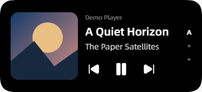
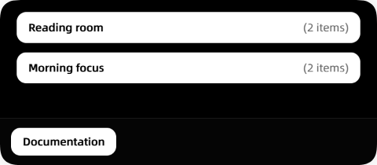
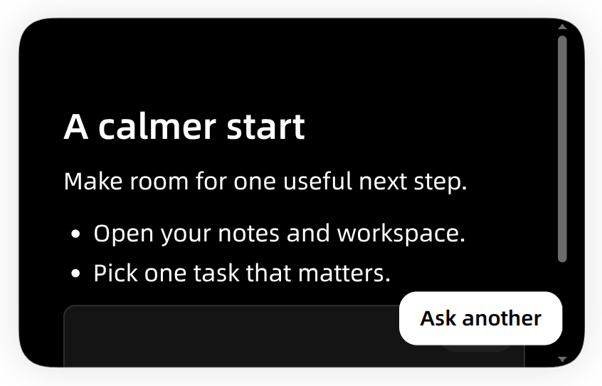
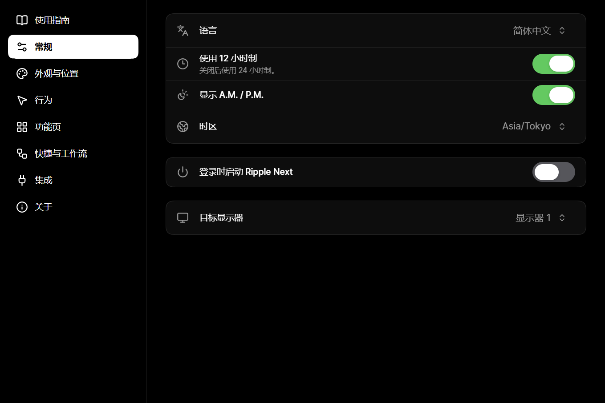
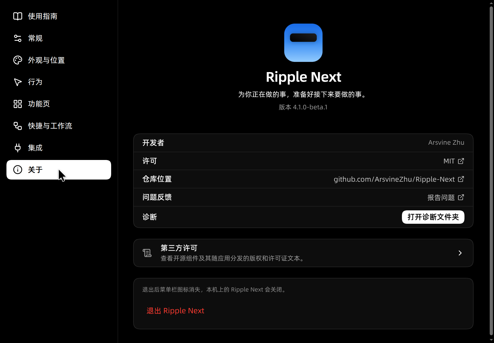
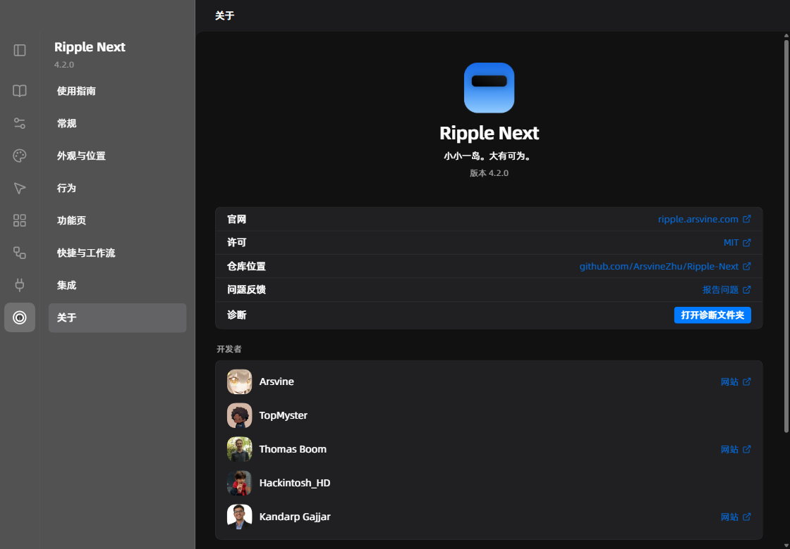
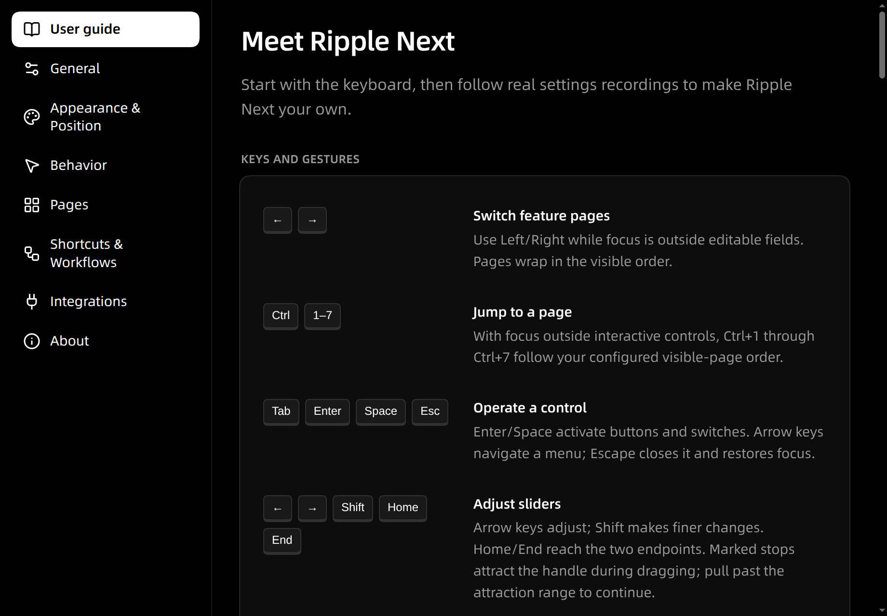

<p align="center"></p>
<h1 align="center">Ripple Next</h1>

<p align="center"><strong>Your next action, close at hand.</strong></p>

<p align="center">
  <a href="README.zh-CN.md">简体中文</a> ·
  <a href="README.zh-TW.md">繁體中文</a> ·
  <strong>English</strong> ·
  <a href="README.ja.md">日本語</a>
</p>

Music is playing. A link needs opening. A copied command is waiting in the clipboard. Ripple Next keeps these everyday actions in one floating Island for Windows, macOS and Linux.

Glance while idle, hover for more, click to open a full page. Configure everything in a dedicated Settings window. Your drafts stay with you when the Island folds.

Ripple Next 4.2.0. [Website](https://ripple.arsvine.com) · [Downloads](https://github.com/ArsvineZhu/Ripple-Next/releases) · [User guide](instructions.md) · [Feedback](https://github.com/ArsvineZhu/Ripple-Next/issues)

> Screenshots and recordings show the actual application with isolated demo content. The assistant example uses a local fixture response, and the media sessions use demonstration players. Chinese images demonstrate the corresponding language feature.

## Seven pages, one place to reach them

| Page                   | Your next action                                                    |
| ---------------------- | ------------------------------------------------------------------- |
| Browser Search         | Search or open an HTTP(S) address in your default browser.          |
| Workflows & Quick Apps | Open a group of apps/addresses in order, or one favorite.           |
| Overview               | See the time, date, battery and configured weather.                 |
| Now Playing            | Choose a player, control playback and bring it forward.             |
| AI Assistant           | Use your chosen service/model with streamed Markdown and code copy. |
| Clipboard              | Reuse recent text from this session.                                |
| Tasks                  | Write the next few things to do; complete them when ready.          |

## Music, within reach

The cover, the artist and the controls stay nearby. Idle is a shorter capsule without a reserved playback-control slot; hovering grows the quick view, adds play/pause and always shows the artist. The artist-visibility preference applies to idle only. Open the full card for previous/next and click the cover to activate its player.

Automatic selection and player indicators make multiple sources easy to browse. Controls belong to the displayed player. Long titles resume scrolling when you return; 3D artwork and intensity are yours to choose. Windows and Linux use native event observation, with metadata and artwork updated independently.




## Open your working context

Give a workflow a name and one app or address per row. Launch once to open the group in order; a failed target reports its own result while later targets continue. Quick apps also launch on their own and can be reused in a workflow.



## An assistant with your choice of service

Configure Chat Completions, OpenAI Responses or Anthropic Messages, save an encrypted key and bind a model. The system prompt is built in. Each model has its own parameters; one personal instruction and the perception channels apply to every model. Answers stream as Markdown; code blocks have native-copy actions. Requests go to the endpoint you configure.



## Make it yours

Arrange built-in, system and imported fonts in glyph-fallback order; choose a theme, colors/background, display, placement, corners and page behavior. Ordinary changes save automatically; credential edits use Save/Change, and destructive actions ask for confirmation. Settings Liquid Glass adds clear pressed lenses, stop attraction and a live preview.

Settings has a compact icon rail with an expandable category panel and an independent translucent-sidebar option.



Simplified Chinese has Standard, Microsoft Chinese and Apple Chinese expressions. Contextual hints, empty states and guide prose have different voices; technical labels, important actions, errors and date/number formats retain their meaning.





## Watch the actual steps

The in-app guide starts with keyboard controls and contains real recordings of font, Chinese expression, glass, workflow and AI editing. English is the capture language except for the Chinese-specific demonstration. Prose stays selectable; videos play only when you choose and pause offscreen.

- [Font](src/assets/guide/typography.webm)
- [Chinese expression](src/assets/guide/expression.webm)
- [Glass](src/assets/guide/appearance.webm)
- [Workflow](src/assets/guide/workflow.webm)
- [AI configuration](src/assets/guide/ai.webm)



## Start using Ripple Next

Download the package for your platform, install it or extract the portable ZIP, then launch Ripple Next. Settings opens first; closing it leaves the Island running. Launch again or use the tray to reopen Settings.

| Platform | Architecture | Packages                 |
| -------- | ------------ | ------------------------ |
| Windows  | x64          | MSI / portable ZIP       |
| Linux    | x64          | DEB / RPM / portable ZIP |
| macOS    | x64 / arm64  | DMG / portable ZIP       |

macOS packages use an ad-hoc signature. Linux needs X11/XWayland and OS-backed encryption for keys; optional native integrations use the tools listed in [platform support](docs/platform-compatibility.md). Island Liquid Glass is unavailable. AI perception can include one desktop frame only after that channel is enabled and the model is marked as supporting images. Windows/Linux keep the tray visible.

Preferences, workflows, quick apps and tasks persist in Ripple Next’s user-data directory; credentials are OS-encrypted. Clipboard history belongs to this run. See [usage and data](instructions.md), [diagnostics](docs/diagnostics.md) and [capture provenance](docs/assets/screenshots/README.md).

## Develop and contribute

Use Node from `.node-version` and pnpm from `package.json`. [Development](docs/development.md), [architecture](docs/architecture.md), [tests](tests/README.md) and the [repository map](INDEX.md) describe the current owners and workflows.

```sh
pnpm install --frozen-lockfile
pnpm start
pnpm check
pnpm test
```
