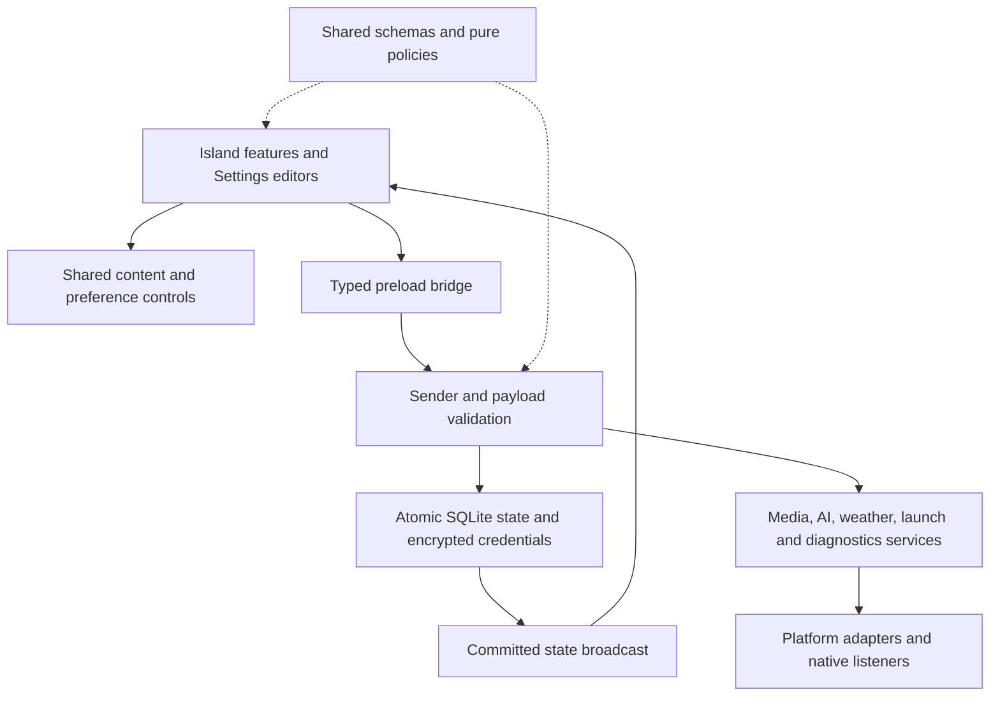

[简体中文](architecture.zh-CN.md) · [Repository map](../INDEX.md)

# Capabilities and ownership

Ripple Next has two renderer windows: the floating Island for daily actions and a Settings window for configuration and editing. Main owns one committed application snapshot, native effects and service lifetimes. Both windows use the same typed preload bridge and receive committed updates.

## Complete user paths

| Capability                       | Runtime path and result                                                                                                                                                                                                                            |
| -------------------------------- | -------------------------------------------------------------------------------------------------------------------------------------------------------------------------------------------------------------------------------------------------- |
| Startup and Settings             | Application profile → native instance lock → SQLite/secure store → Island and Settings bootstrap. Launching again opens the existing Settings window. Closing Settings keeps the Island running.                                                   |
| Preferences, display and startup | Settings control → AppStateProvider → validated IPC → native effects → atomic store commit → both-window broadcast. Failed native effects retain the committed value.                                                                              |
| Search                           | TextEntry → URL/template resolution → openExternal → system browser. Errors remain beside the input.                                                                                                                                               |
| Workflows and quick apps         | Settings editor → typed LaunchTarget → persistence; Island LaunchButton → one ordered target array → main orchestration → platform activation → indexed per-target results.                                                                        |
| Overview                         | Clock preferences → Intl formatting; WeatherPreferences → weather service → provider/cache → reading/location/error; browser battery events → battery state.                                                                                       |
| Music                            | Native adapter → media service → shared snapshot/selection → cards. Controls and player activation address the displayed session ID. Metadata and artwork update separately.                                                                       |
| AI                               | Settings endpoint/credential/model graph → secure records → selected model and resolved prompt → protocol SDK stream → assistant lifecycle → Markdown/native-copy controls. Cancellation and partial failure preserve the owning request's result. |
| Clipboard                        | Explicit native read → bounded in-memory history → row copy → native write. History contains at most 100 entries and one million characters, and resets on exit.                                                                                   |
| Tasks                            | Feature-owned draft → tasks patch → atomic persistence → broadcast. Completing a task removes it from the active list.                                                                                                                             |
| Device alerts                    | Battery events/native device observation → alert queue → Island state/border. An alert preserves an already expanded page; device failures remain source-local.                                                                                    |
| Guide, About and licenses        | Bundled real recordings/posters → user-controlled playback; product metadata and known license records → Settings.                                                                                                                                 |
| Diagnostics                      | Validated operation/view events → main bounded log/crash directory → diagnostics-folder action.                                                                                                                                                    |
| Build and release                | pnpm checks → Forge/Vite main/preload/renderer → native modules/resources → platform makers → versioned release artifacts. Publication uses a verified version tag on the reviewed commit, as described in the release guide.                      |

## Layer boundaries

Main services own domain orchestration; adapters own native discovery, preparation, identifiers and caches. Shared modules contain runtime-neutral data and policies. Preload exposes named methods and unsubscribe functions. Renderer files compose the common controls and perform their feature's operations.

AppStateProvider keeps pending edits separate from committed state and coalesces writes. Main commits only affected settings or feature lists. Related AI graph and credential deletions share the transaction. Read failures remain errors rather than replacing saved data with defaults.

## Native observation

The macOS window adapter applies and verifies the native Island collection behavior after visibility and focus changes. The native module owns the Stationary policy; Settings retains ordinary window behavior. See [platform support](platform-compatibility.md) for desktop behavior and validation.

Windows uses the supervised MTA executor for GSMTC, Bluetooth DeviceWatcher and capture registry events. Linux uses MPRIS and BlueZ signals, incremental PipeWire/PulseAudio streams and the bundled C inotify camera listener. Healthy event backends do not run periodic samplers. macOS samples the dictionaries of running Spotify/Music every five seconds and uses its native device probes. Its media adapter owns asynchronous, generation-guarded Apple Music cover decoding and caching; cover completion notifies the shared media service immediately. See [native observation](native-observation.md) and [platform support](platform-compatibility.md).

MPRIS session IDs include the unique D-Bus owner. Property signals update cached metadata directly; local cover reads use per-session generations so late results cannot overwrite the current track. Every window subscribes to the same main-owned snapshot and selection.

## Renderer composition and lifecycle

Content owns ActionButton, TextEntry, EmptyState, Feedback and Surface. Preferences compose those primitives with reusable rows/cards/fields; specialized switches, sliders, selectors and colors share their own modules. LaunchButton, MediaControl, MediaArtwork, MediaMarquee, MediaTransition and MarkdownContent own behavior reused by feature surfaces.

The page registry owns stable IDs, visibility/order, geometry and rendering. Feature pages own drafts. React Activity preserves them while hiding pages and pausing page effects. Media/device/clipboard observation and active assistant work stay above that lifecycle. The interaction machine owns collapse, menus, focus and active-assistant guards. Geometry exits use the normal delayed collapse path, held only while an interaction blocker is active. Window blur and hidden-page focus release input ownership. Hover scaling has its own immediate 160 ms transition. Hover quick view returns without a hold delay; fully expanded pages use the configured collapse delay; geometry follows current visible dimensions and fractional display/input coordinates.

TabPanels renders one shared page rail. useWheelPageRail owns Windows/Linux directional paging, momentum-tail suppression, interruption and elastic return. useMacPageRail and usePageSwipe own macOS contact phases, reversible displacement and release-based selection; PageSwipe limits each contact to one neighbor. Native macOS momentum cannot select another page. New profiles use a padded 24-hour clock; existing explicit clock preferences remain intact.

SettingsApp owns a persistent icon rail and an optional category panel. Sidebar expansion and translucency use main-owned settings; native window materials remain in settingsWindow. Windows settings retains the system frame, corners, caption buttons and window animations with a native acrylic backdrop. The content pane stays opaque, and sidebar changes retain mounted editors and navigation state. Free placement uses matching percentage anchors and translations so position follows visible width. Idle time/battery information enters quick view on hover and expands on click.

Idle music omits the playback-control slot. Hover quick view adds that width and always includes the artist. Both card sizes measure text against the actual viewport and use a CSS marquee. Track changes retain one keyed current content layer, and hidden-page restoration restarts measurement/animation.

## Resources, validation and availability

The persisted uiFont list owns font priority across Settings and Island. Main font service imports unchanged files into the profile, reads family/style metadata with fontkit and serves hash-addressed assets. Platform adapters own installed-family discovery; useUIFont registers browser FontFace resources and publishes the ordered CSS stack. Existing single-font preferences normalize into the same list on load.

Fonts and third-party notices ship as original resources. Guide videos and promotional screenshots capture actual application flows with isolated demo data; English is the default capture language. Tests are organized by [platform, feature and shared ownership](../tests/README.md).

Island Liquid Glass and AI context awareness are unavailable. Windows/Linux keep the tray visible. The application does not collect desktop content for AI context awareness or maintain a completed-task archive. These states are reflected in the interface and usage guide.

Settings controls share compact dimensions, blue accent states and OS light/dark surface tokens. Slider hit testing uses the same thumb width as its CSS geometry; glass handles reveal a restrained lens while pressed without moving the value axis.
