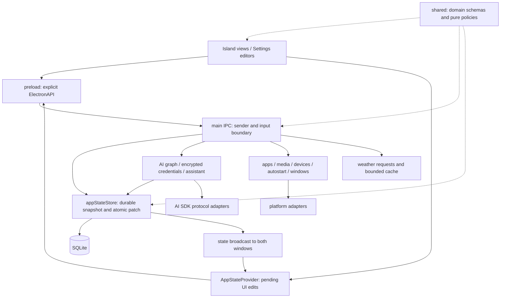

# Feature and capability map

This map covers the repository-wide refactor of PR #14. An entry point, a connected implementation and a working runtime flow are separate facts. Runtime results are updated as each path is changed. Version 4.1.0-beta.1 remains unreleased.

## Objective, decisions and current work

- **Objective:** preserve actual features, three model protocols, native integrations, layouts and packaging while reducing code, conversions, duplicated steps and coupling.
- **Decisions:** remove obsolete internal compatibility paths. Main owns persistence and system effects; shared owns serializable domain contracts; renderer owns presentation and interaction. Keep necessary encryption, transactions, native input regions and resource notices.
- **Current work:** Persistence, both-window synchronization and task restart are implemented. Launch targets, weather preferences and native preference commits are unified. Current work proceeds to complete AI execution and the remaining runtime owners. Continue through every path below.

## User paths

| Capability and official entry                                 | Data flow and result                                                                                                                                      | Supported behavior and remaining verification                                                                                                                                                             |
| ------------------------------------------------------------- | --------------------------------------------------------------------------------------------------------------------------------------------------------- | --------------------------------------------------------------------------------------------------------------------------------------------------------------------------------------------------------- |
| Launch, repeated launch, tray/menu Settings                   | main/index → profile/instance lock → state/services → Island/Settings windows → preload → renderer bootstrap                                              | Windows packaged startup, both-window synchronization, restart and unreadable-setting error UI verified; database-open failure feedback remains to inspect                                                |
| Appearance, fonts, language, glass, placement, display, pages | Settings → AppStateProvider patch → IPC → store → broadcast → both renderers; display/autostart also call native effects                                  | Unified preference commits apply native display/autostart operations before persistence; invalid displays and unavailable startup leave saved values intact. Restart display restoration is main-owned.   |
| Browser Search                                                | input → URL/template resolution → openExternal → default browser; inline errors                                                                           | Connected; actual browser opening still needs verification; remove browser-only fallback                                                                                                                  |
| Workflows and Quick Apps                                      | Settings → persisted targets; Island launch → preload → main → URL/command/native app → row result                                                        | Unified LaunchTarget/batch IPC/platform capability; Windows browser opening, continuation after failure and argv/cwd verified; quick apps also launch independently in the compact page with no workflows |
| Overview                                                      | clock preferences → Intl; location/unit → main weather service → WeatherAPI → reading/location/error; browser battery API                                 | One weather-preferences model and one renderer hook; actual weather lookup, automatic address display, preserved manual fields and restart verified on Windows.                                           |
| Music                                                         | renderer polling → media service → GSMTC / running Spotify or Music / MPRIS → session snapshot → selection/control/activation → card                      | Connected; verify an actual Windows player; macOS/Linux need their hosts; preserve explicit session identity and capabilities                                                                             |
| AI configuration and answers                                  | Settings endpoint/key/model → graph + encrypted store → active model → Island prompt → assistant → three SDK protocols → delta/error/done → Markdown/copy | Connected; verify HTTP streaming through the packaged app, not a substituted stream function; consolidate duplicated error/diagnostic lifecycles                                                          |
| Clipboard                                                     | native read → bounded session history → entry → native write                                                                                              | Connected; verify actual OS copying; clearing at restart is intentional                                                                                                                                   |
| Tasks                                                         | Island text → tasks patch → SQLite → broadcast/restart; completion removes an entry                                                                       | Verified in packaged Windows app: native typing, restart persistence, completion and both-window synchronization                                                                                          |
| Device alerts                                                 | battery/Bluetooth/camera/microphone → alerts → Island mode/border; errors → notice/diagnostics                                                            | Connected; verify sampling/error ownership and native devices                                                                                                                                             |
| Guide, About, licenses, diagnostics                           | local recordings/resources → Settings; license selection → main file read; diagnostics → bounded local logs/crashes                                       | Connected; preserve genuine footage and original fonts/notices; remove temporary capture helpers and redundant diagnostic tests                                                                           |
| Build and release                                             | pnpm → Forge/Vite → sandbox preload/native modules/assets → platform makers → CI artifacts                                                                | Connected; verify Windows package and other native makers on matching hosts; no release or PR merge in this work                                                                                          |

Unavailable capabilities: Island Liquid Glass and AI context awareness remain disabled. Full long-conversation/task migration and optional Windows/Linux tray behavior are not implemented. Present these states directly rather than claiming placeholder implementations are usable.

## Internal ownership

| Owner                 | Data, rules and complete operations                                           | Hidden implementation and dependency direction                                          |
| --------------------- | ----------------------------------------------------------------------------- | --------------------------------------------------------------------------------------- |
| Application lifecycle | profiles, instance lock, windows/tray, shutdown                               | Electron stays in main; development isolation is separate from feature state            |
| Persistence           | settings/tasks/workflows/quickApps, ciphertext, atomic patches                | appStateStore hides SQL, paths and transactions; callers submit domain objects          |
| AI configuration      | endpoint/key/model references, identity, related deletion, credentials        | graph service calls storage; renderer neither allocates identities nor receives keys    |
| AI execution          | selected model, prompt/injections, protocol settings, cancellation, streaming | main hides SDK/network; renderer consumes request results/errors                        |
| Launch targets        | app/URL/command targets and ordered group launch                              | adapters hide shell/desktop files/WinRT; workflows and quick apps should share targets  |
| Media                 | selection, capabilities, operations, error snapshots                          | main selects/serializes; adapters read/control; renderer does not infer native identity |
| Weather               | location/unit, credential mode, concurrent requests, bounded cache            | main hides keys/API; shared owns serializable location/reading/error                    |
| Island layout/input   | page identity/order, geometry, mode, focus/leave/gestures                     | shared policies; renderer animation; main native input regions                          |
| Settings interaction  | categories/editors, controls, edits, confirmation, scroll/focus               | Settings owns edits; no routing through the large Island controller                     |
| Liquid Glass          | refraction algorithm, bitmap cache, press/drag/menu highlight                 | retain algorithm provenance; consolidate material/interaction entry points              |
| Resources/tools       | fonts/notices/recordings; development/package scripts                         | preserve licenses; generated .vite/out stay outside production APIs                     |

## Confirmed reductions and order of work

1. **Persistence:** delete historical page/AI migrations, schema-version checks and SQL dispatch wrappers; write only changed data. Remove default-state/error-side-channel loading. Preserve atomic transactions and OS encryption.
2. **Island/Settings:** remove unused Settings operations and quick-app editing state from Island; feature owners keep their own state.
3. **Launch targets:** use structured targets for workflows; main launches the group. Remove string re-inference, advance cache-building IPC and fixed sleeps.
4. **Location/system state:** one automatic/manual location representation and one external-query conversion; commit display/autostart effects with their state.
5. **AI:** verify provider streaming, cancellation, failures and retry; consolidate validation/diagnostics; retire generated-name parsing and font aliases.
6. **Repository maintenance:** inspect large Settings files, glass layers, platform commands, shared types, tests and scripts. Remove redundant tests and completed verification scaffolding. Update owner documentation and verify all user paths.

These are evidence-backed starting points, not the whole scope. Keep queues that solve actual concurrency: media operations, durable writes, pending renderer edits and cross-window broadcasts have distinct responsibilities. Initial native input-region confirmation protects transparent-window clicks and is not a business checkpoint.

## Runtime data and maintenance

Completed in this pass: one committed persistence snapshot, changed-data writes, direct read errors and an unreadable-setting startup view; removal of redundant Island editors/page-edit operations and delayed browser-guide opening. The packaged Windows app passed real Settings inputs, native task typing, restart restoration and completion. Corrupt demo settings reproduced the error view. This pass also unifies Application/LaunchTarget, removes renderer launch loops, fixed waits and three superseded IPC methods, and moves native activation/discovery/cache to platform adapters and quick-app drafts to their editor. Weather preferences, refresh ownership and native preference commits are now unified and verified on Windows. Database-open failure feedback, complete AI execution and the remaining runtime owners still require work.

SQLite and OS-encrypted records are durable. Clipboard, requests and previews are session state. Weather cache: 20 entries/60 seconds. Logs: 5 MiB. Crash reports: newest 10 and no older than 30 days. Windows application discovery is on demand; its adapter shares a five-minute memory cache without preparation or file round trips. .vite/out are regenerable builds. Do not erase user data to make runtime verification pass.

Baseline c916b0c: production TS/TSX/CSS/SQL, 237 files/22,418 nonblank lines; scripts, 4 files/203 lines; tests/fixtures, 63 files/6,645 lines. Reduction must come from implementation cost, not deleting features, algorithms or notices.

Navigation: [Development](development.md) · [Platform support](platform-compatibility.md) · [Repository map](../INDEX.md)
