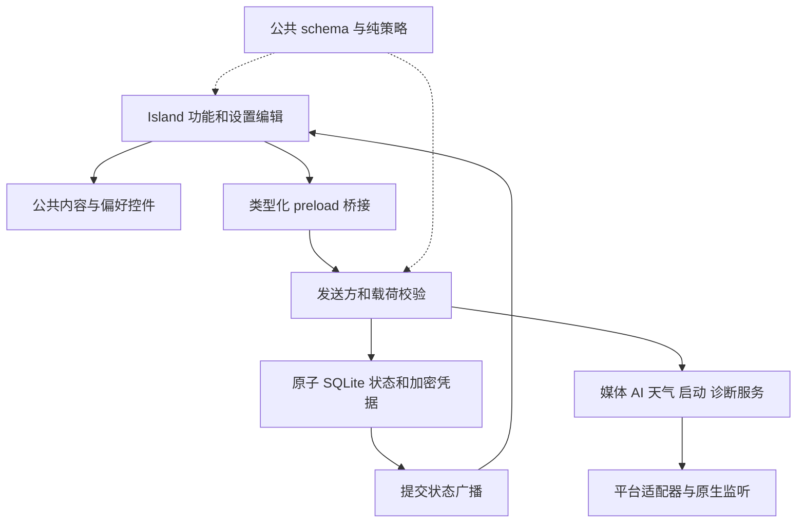

[English](architecture.md) · [仓库地图](../INDEX.zh-CN.md)

# 能力与责任归属

Ripple Next 有两个渲染窗口：Island 用于日常操作，设置窗口用于配置和编辑。主进程维护唯一的已提交状态、原生系统效果和服务生命周期；两个窗口共用类型化 preload 桥接并接收提交后的更新。

## 完整用户路径

| 能力               | 运行路径与结果                                                                                                                                 |
| ------------------ | ---------------------------------------------------------------------------------------------------------------------------------------------- |
| 启动与设置         | 应用配置目录 → 原生单实例锁 → SQLite／安全存储 → Island 和设置初始化；再次启动打开已有设置，关闭设置保留 Island。                              |
| 偏好、显示器与启动 | 设置控件 → AppStateProvider → 校验后的 IPC → 原生效果 → 原子保存 → 双窗广播；系统效果失败时保留已提交值。                                      |
| 搜索               | TextEntry → 网址／模板解析 → openExternal → 系统浏览器；错误显示在输入旁。                                                                     |
| 工作流与快捷应用   | 设置编辑 → LaunchTarget → 持久化；Island LaunchButton → 有序目标数组 → 主进程编排 → 平台激活 → 按目标返回结果。                                |
| 概览               | 时钟偏好 → Intl；WeatherPreferences → 天气服务／供应方／缓存 → 天气与地址或错误；浏览器电池事件 → 电量。                                       |
| 音乐               | 原生适配器 → 媒体服务 → 共用快照／来源选择 → 卡片；控制及唤起携带当前卡片会话 ID，元数据与封面独立更新。                                       |
| AI                 | 设置接口／凭据／模型图 → 加密记录 → 当前模型与解析后的提示词 → SDK 协议流 → 助手生命周期 → Markdown／原生复制；取消和部分失败归属于原请求。    |
| 剪贴板             | 原生读取 → 有界内存历史 → 行内复制 → 原生写入；最多 100 条、100 万字符，退出后清空。                                                           |
| 任务               | 功能草稿 → tasks patch → 原子保存 → 广播；完成后从活动列表移除。                                                                               |
| 设备提醒           | 电池事件／原生设备监听 → 提醒队列 → Island 状态／边框；提醒保留已展开页面，失败局限于对应来源。                                                |
| 指南、关于与许可   | 实际录像／封面 → 用户控制播放；产品元信息和指定许可记录 → 设置。                                                                               |
| 诊断               | 校验后的操作／视图事件 → 主进程有界日志与崩溃目录 → 打开诊断目录。                                                                             |
| 构建与发布         | pnpm 检查 → Forge／Vite 主进程、preload、界面 → 原生模块和资源 → 平台 maker → 版本软件包；经审查的提交通过版本标签触发验证与发布，见发布流程。 |

## 分层边界

主进程服务负责领域编排，适配器负责原生发现、准备、身份和缓存。共享层提供运行时无关的数据与策略。preload 暴露具名方法和取消订阅函数；界面功能组合公共控件并执行所属操作。

AppStateProvider 分离待提交与已提交状态，合并写入。主进程只提交变化的设置或功能列表，AI 图和相关凭据删除位于同一事务。读取失败直接报错，不用默认值覆盖已保存数据。

## 原生监听

macOS 窗口适配器在 Island 显示或聚焦后应用并校验原生窗口行为；原生模块负责 Stationary 策略，设置窗口保持普通窗口行为。桌面行为及验证方式见[平台支持](platform-compatibility.zh-CN.md)。

Windows 使用常驻 MTA 执行器监听 GSMTC、蓝牙 DeviceWatcher 和采集注册表。Linux 使用 MPRIS／BlueZ 信号、PipeWire／PulseAudio 增量流及内置 C inotify 摄像头监听器。事件后端正常时没有周期采样；macOS 每五秒查询运行中 Spotify／Music 的字典并使用设备探测。媒体适配器负责 Apple Music 封面的异步解码、按代次校验及缓存，封面完成后立即通知共用媒体服务。见[原生监听](native-observation.zh-CN.md)和[平台支持](platform-compatibility.zh-CN.md)。

MPRIS 会话 ID 包含唯一 D-Bus owner。属性信号直接更新缓存元数据，本地封面按会话代次读取，迟到结果不能覆盖当前曲目。双窗订阅相同的主进程快照及选择。

## 界面组合与生命周期

公共内容模块管理 ActionButton、TextEntry、EmptyState、Feedback、Surface；偏好模块基于这些控件组合行、卡片和字段。开关、滑杆、选择器与颜色使用各自的公共模块。LaunchButton、MediaControl、MediaArtwork、MediaMarquee、MediaTransition、MarkdownContent 管理跨功能复用的行为。

页面注册表管理稳定 ID、可见性、顺序、几何和渲染。功能页持有草稿，React Activity 隐藏页面并暂停效果时保留草稿；媒体、设备、剪贴板和活动助手位于这个生命周期之上。交互状态机管理折叠、菜单、焦点和活动助手状态。几何退出走正常的延时收起流程，仅在交互阻止条件有效时保持展开；窗口失焦或输入页隐藏时释放输入占用。悬停缩放使用独立的 160 毫秒即时过渡，悬停快览离开后不额外等待，完整展开页才使用设置中的收起延时；几何跟随当前可见尺寸及分数缩放坐标。

TabPanels 统一渲染页面轨道。useWheelPageRail 管理 Windows/Linux 的方向翻页、惯性尾部抑制、动画接管和弹性回位；useMacPageRail 与 usePageSwipe 管理 macOS 接触阶段、可逆位移和释放判定，PageSwipe 限制每次接触最多选择相邻一页。macOS 原生惯性不选择新页面。新配置默认使用补零的 24 小时制，已有明确时间偏好保持不变。

SettingsApp 管理常驻图标栏及可展开分类面板。侧栏展开状态和半透明偏好通过主进程持久化；settingsWindow 管理原生窗口材质；Windows 设置窗口保留系统边框、圆角、标题栏按钮和窗口动画，背景使用原生 acrylic。主内容保持不透明。切换侧栏保留编辑器与导航状态。手动定位以匹配的百分比锚点和位移跟随可见宽度。空闲时间电量入口悬停进入快览，点击完整展开。

音乐 idle 不预留播放键空间；悬停快览加宽并始终显示歌手。两种卡片按实际 DOM 文字和裁切区宽度执行 CSS 滚动，换曲只保留一个当前层；隐藏页面恢复后重测并重新启动动画。

## 资源、验证与可用性

持久化 uiFont 列表统一管理设置与 Island 的字体优先顺序。主进程字体服务将原始文件导入配置目录，用 fontkit 读取家族／样式元数据，并通过内容哈希寻址协议提供资源。平台适配器管理系统家族发现，useUIFont 注册浏览器 FontFace 并应用有序 CSS 字体链。已有单字体偏好在加载时归一化为同一列表。

字体及第三方声明以原始资源分发。指南和宣传素材来自独立演示配置中的实际操作，默认使用英文。测试按[平台、功能与公共契约](../tests/README.zh-CN.md)分类。

Island 液态玻璃与 AI 上下文感知尚未开放；Windows／Linux 保持托盘可见。应用不会为上下文感知收集桌面内容，也不维护已完成任务归档；界面和指南明确表达这些状态。

设置控件共用紧凑尺寸、蓝色强调状态和系统明暗表面 token。滑块命中计算与 CSS 几何使用同一手柄宽度；按下时呈现克制的玻璃透镜，不偏移数值轴。
