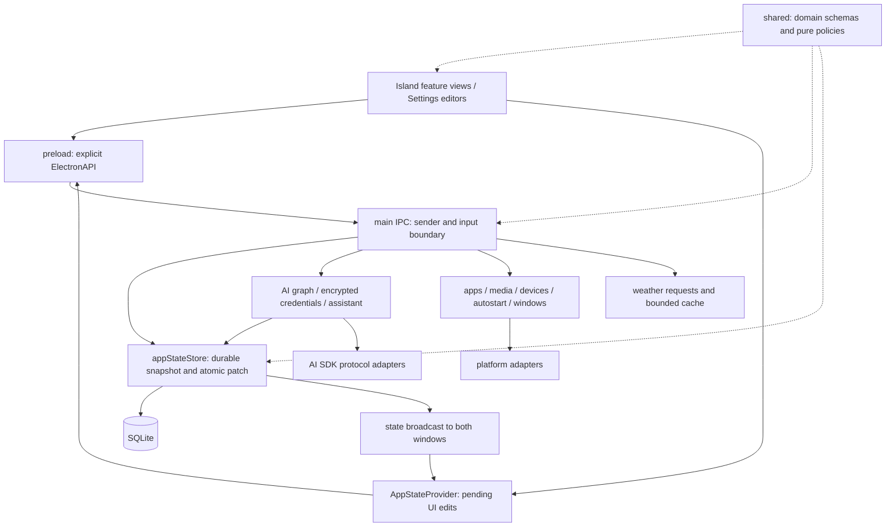

# 功能与内部能力地图

本地图从 PR #14 的当前实现出发，覆盖全库整改。入口存在、代码接通、实际运行通过是不同状态；下面的运行核验随整改更新。版本保持 4.1.0-beta.1 未发布。

## 目标与当前工作

- **目标**：保留真实功能、三种模型协议、原生系统集成、布局和打包能力，统一数据和操作，明显减少代码、转换、重复流程及跨模块修改。
- **决定**：不维持历史内部兼容路径；主进程拥有持久化与系统效果；共享层只定义正式数据；渲染层拥有展示和交互。保留必要的加密、事务、输入区域及资源许可。
- **当前工作**：首先整改启动 → 状态读取 → 设置/功能修改 → 持久化 → 两窗口同步 → 重启读取。之后沿下表每条完整路径继续，不能以局部测试或这条路径完成代替全库完成。

## 用户路径

| 能力与官方入口                               | 数据流与结果                                                                                                                                           | 当前支持与待核验                                                                                           |
| -------------------------------------------- | ------------------------------------------------------------------------------------------------------------------------------------------------------ | ---------------------------------------------------------------------------------------------------------- |
| 启动、再次启动、托盘/菜单打开设置            | `main/index` → app profile/实例锁 → 状态与服务 → Island/Settings BrowserWindow → preload → renderer bootstrap                                          | Windows 打包启动、双窗同步、重启保留及损坏设置的错误页面已核验；数据库文件打不开时的启动反馈继续检查       |
| 外观、字体、语言、玻璃、位置、显示器、功能页 | Settings 编辑 → AppStateProvider patch → IPC → state store → 广播 → 两个 renderer；显示器和自启动另有系统调用                                          | 已接通；显示器/自启动的旁路提交需要收拢，Island 不应携带设置窗编辑器                                       |
| 浏览器搜索                                   | Search 输入 → URL/template 解析 → `openExternal` → OS 默认浏览器；失败在搜索页显示                                                                     | 已接通；真实浏览器打开待本次核验，浏览器 fallback 可删                                                     |
| 工作流和快捷应用                             | 设置编辑 → 正式目标 → 持久化；Island 启动 → preload → 主进程 → URL/命令/原生应用 → 行内结果                                                            | 已接通；工作流仍用字符串重新猜测目标，快捷应用用结构化目标；应统一，删除逐条 400ms 等待                    |
| 概览：时间、日期、天气、电量                 | Settings 时间/位置 → Intl 时钟；天气 → 主进程服务 → WeatherAPI → reading/location/error；电量 → 浏览器系统电池 API                                     | 已接通；位置同时存 tuple/query/sentinel，重复转换应删；实际天气及异常待核验                                |
| 音乐                                         | renderer 轮询 → media service → Windows GSMTC / macOS Spotify、Music / Linux MPRIS → session snapshot → 选择、控制和激活 → 更新卡片                    | 已接通；真实 Windows 播放器待核验，macOS/Linux 需对应主机；会话身份、显式控制目标和原生能力应保留          |
| AI 配置和回答                                | Settings endpoint/key/model → graph service + encrypted store → 选择模型 → Island prompt → assistant → SDK 三种协议 → delta/error/done → Markdown/复制 | 已接通；需要实际 HTTP 流经打包应用并显示结果，不能只替换 stream 函数测试；请求错误和诊断重复生命周期待收拢 |
| 剪贴板                                       | native read → 会话内有界历史 → 选择条目 → native write                                                                                                 | 已接通；定时器和焦点刷新，真实系统复制待核验；重启清空是产品行为                                           |
| 任务                                         | Island 文本 → tasks patch → SQLite → 广播/重启；完成即移除                                                                                             | Windows 打包应用已通过键盘新增、重启保留、勾选完成及两窗同步                                               |
| 设备提醒                                     | 电量和蓝牙/摄像头/麦克风读取 → alerts → Island 模式/边框；失败 → notice/diagnostics                                                                    | 原生读取已接通；采样和错误 owner 待核验，不能为缺设备伪造正常状态                                          |
| 使用指南、关于、许可与诊断                   | 本地录屏/资源 → Settings；许可列表 → main 读取指定记录；诊断 → 有界本地日志与 crash folder                                                             | 已接通；保留真实录像、字体原文件及许可；清理临时采集脚本与重复诊断测试                                     |
| 构建和发布                                   | pnpm → Forge/Vite → sandbox preload + native modules + assets → 平台 maker → CI artifacts                                                              | Windows package 与运行核验通过；其他平台按对应主机验证；当前不发布、不合并 PR                              |

尚未开放的能力：Island Liquid Glass 和 AI 上下文感知在设置中禁用。完整长会话/任务迁移及 Windows/Linux 可选托盘未实现。它们应直接表达未开放，不能靠兼容壳或占位实现宣称可用。

## 内部能力及责任

| 所属能力         | 数据、规则和完整操作                                       | 隐藏的实现与依赖方向                                                              |
| ---------------- | ---------------------------------------------------------- | --------------------------------------------------------------------------------- |
| 应用生命周期     | profile、实例锁、窗口/托盘生命周期、退出                   | Electron 只在 main；开发数据隔离不替代功能状态                                    |
| 持久化           | settings/tasks/workflows/quickApps、加密字节、patch 原子性 | SQL、文件路径和事务只属于 appStateStore；调用方提交正式对象，不组织表写入         |
| AI 配置          | endpoint/key/model 引用、稳定身份、删除关联、凭据保存      | main graph service 调用存储；renderer 不分配身份、不接收密钥                      |
| AI 执行          | 选定模型解析、模板/注入、协议参数、取消、流式结果          | SDK/网络在 main；renderer 消费一个请求的结果与错误                                |
| 启动目标         | 应用/URL/命令目标和按序启动                                | platform adapters 隐藏 shell、desktop file、WinRT；工作流和快捷应用应共用正式目标 |
| 媒体             | 会话选择、能力、操作结果、错误快照                         | main service 选择/串行化，平台只实现读取和操作；renderer 不推断系统会话身份       |
| 天气             | 位置、单位、凭据模式、并发请求和有界缓存                   | main 隐藏密钥/API，shared owns serializable location/reading/error                |
| Island 布局/输入 | 页面身份/顺序、目标几何、模式、焦点/离开/手势              | shared owns geometry/page policies；renderer owns动画；main owns原生输入区域      |
| 设置交互         | 分类/二级页、控件、编辑、确认、滚动/焦点恢复               | Settings owner；不经 Island 大控制器传递编辑操作                                  |
| Liquid Glass     | 真实折射算法、位图缓存、按压/拖动/菜单高亮                 | 保留现有算法来源；统一材料与交互入口，关闭时无玻璃鼠标响应                        |
| 资源/工具        | 字体、许可、录像；开发/打包脚本                            | 资源许可保持完整；生成目录 `.vite`/`out` 不进入生产 API                           |

## 已确认的减量点与整改顺序

1. **持久化完整路径**：删除旧版页面/AI 迁移、schema version 核对和 SQL 分发包装；patch 只写受影响数据。取消读取默认值与 `getLoadError` 双通道；保留数据库事务和 OS 加密。
2. **Island 与设置职责**：删除 Island 控制器未使用的设置操作和快捷应用编辑状态；页面编辑操作由 Settings 持有；将实际功能状态交还各功能 owner。
3. **启动目标完整路径**：工作流统一结构化目标，主进程负责整组启动；移除字符串二次推断、提前 build-cache IPC 和固定等待。
4. **位置/状态正式数据**：统一自动/手动位置表示，在天气 owner 转换一次外部查询；将显示器与自启动系统效果和提交合为一次操作。
5. **AI 完整路径**：真实服务调用、流式显示、取消/失败/重试；收拢重复校验、诊断生命周期、可删除名称兼容解析和字体 alias。
6. **全库维护成本**：检查 Settings 长文件、玻璃重复层、平台重复命令、共享 types、测试和脚本；删除无独有行为保护的测试及验证结束后的脚手架。文档随 owner 修改，最后核验全部真实路径。

这些是当前证据支持的切入点，后续发现同类问题继续归入所属路径。媒体命令序列、状态写入序列、renderer 乐观编辑合并和跨窗口广播各自解决真实并发问题，不能仅因使用 queue 就删除。原生输入区域确认解决透明窗口实际点击问题，也不是业务检查点。

## 运行与维护

本轮已完成持久化快照与按变化提交、直接读取错误、设置损坏的启动错误页、Island 冗余编辑器/页面操作清理，以及延迟打开网页指南的删除。Windows 打包应用通过实际设置控件、原生键盘新增任务、重启恢复和勾选完成；读取错误通过损坏演示配置复现。数据库文件打不开时的启动反馈、统一启动目标、位置模型及其他功能路径仍在整改范围内。

当前只保留 SQLite 正式状态和 OS 加密记录；剪贴板/请求过程/预览属于会话状态。天气缓存上限 20 项、60 秒，日志上限 5 MiB，crash reports 保留最新 10 份且不超过 30 天。Windows installed-apps 缓存为一个替换写入文件，需整改其重复准备流程。`.vite`/`out` 为可重新生成的构建目录；不要删除用户数据来通过运行核验。

整改基线提交 `c916b0c`：生产 TS/TSX/CSS/SQL 237 文件、22,418 非空行；脚本 4 文件、203 行；测试及 fixture 63 文件、6,645 行。统计用于判断实质减量，不能通过删除算法、功能或许可资源追求数字。

导航：[开发](development.zh-CN.md) · [平台支持](platform-compatibility.zh-CN.md) · [仓库地图](../INDEX.zh-CN.md)
